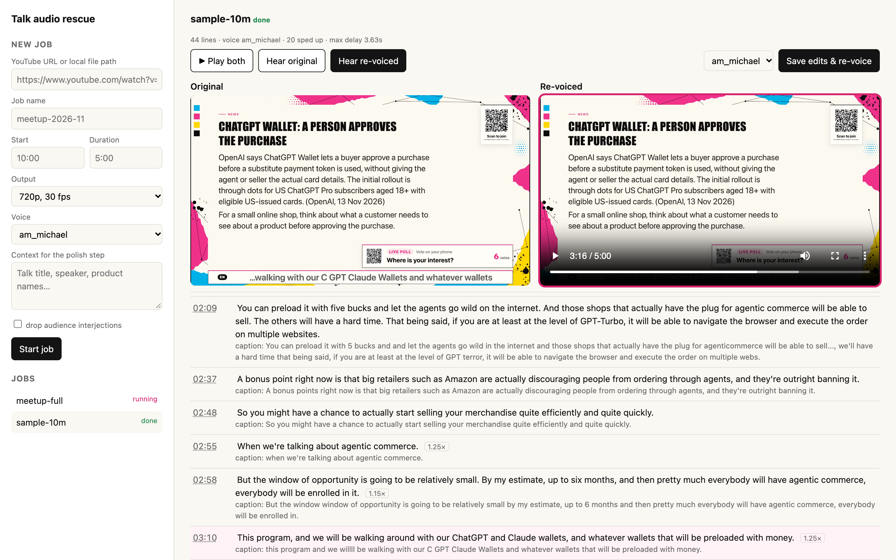
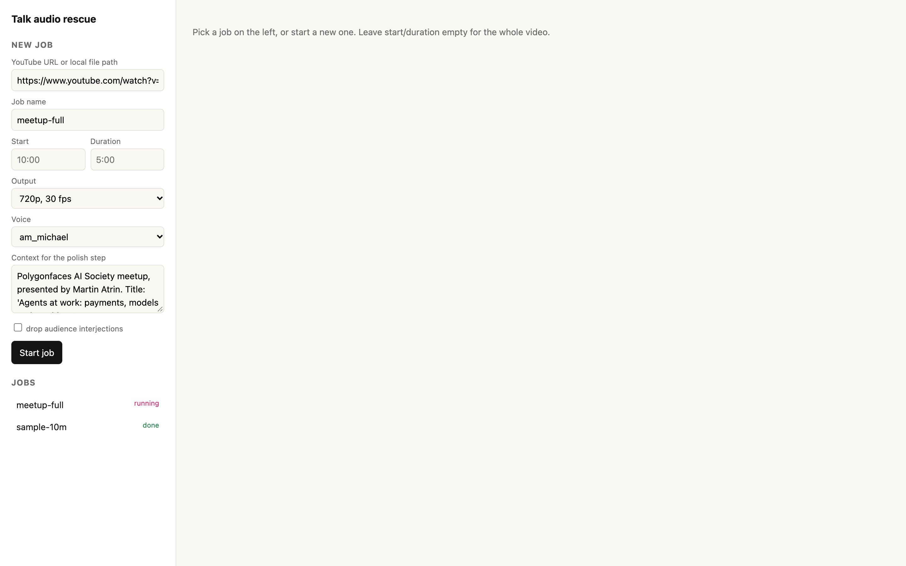
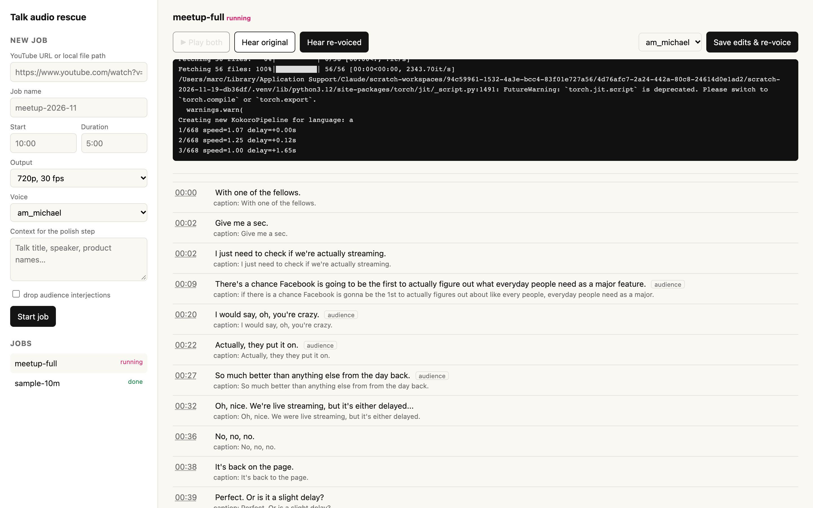
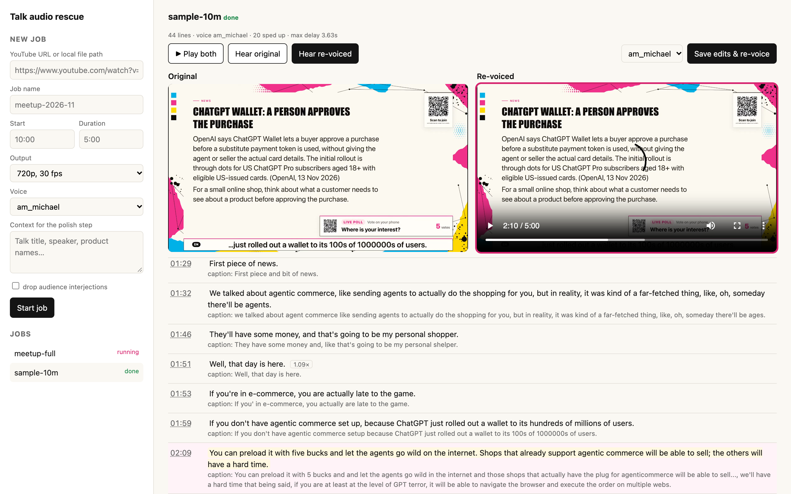

# livestream-audio-rescue

Re-voice a recorded talk whose audio is unusable, using the **live captions burned into the video**.



Our meetup livestream had unusable audio: both microphones in the room were recorded at once and mixed into one track. But a live-caption bar ran along the bottom of every slide. This tool reads that bar back with OCR, cleans the text up with an LLM, speaks it with a local text-to-speech voice and puts it back under the video, in time with the slides.

**Write-up with a before/after clip:** [The audio was gone. The captions weren’t.](https://doyouknowmarc.com/blog/livestream-audio-rescue/)

```
video ─► crop caption bar ─► Apple Vision OCR ─► stitch scrolling lines ─► LLM polish ─► Kokoro TTS (MLX) ─► fit to timeline ─► remux
```

It is made for slide-based talks: there is no face to lip-sync, so a clear narrator voice that keeps roughly the original timing is enough. A 70-minute talk takes about 20 minutes on an Apple Silicon Mac.

---

## Requirements

- **macOS on Apple Silicon.** OCR uses Apple Vision and the voice runs on MLX.
- **Homebrew** tools: `ffmpeg`, `yt-dlp`, `espeak-ng`, `uv`
- **Optional:** the [Claude Code](https://claude.com/claude-code) CLI (`claude`), logged in, for the polish step. Without it the polish step only does rule-based fixes.
- About 1 GB of disk for the Python environment and the voice model, plus room for the video you process.

## Setup

```bash
git clone https://github.com/doyouknowmarc/livestream-audio-rescue.git
cd livestream-audio-rescue
brew install ffmpeg yt-dlp espeak-ng uv
./setup.sh
```

`setup.sh` checks the tools, creates `.venv/` with Python 3.12 and installs the pinned packages from `requirements.txt`. The Kokoro voice weights (`mlx-community/Kokoro-82M-bf16`, ~330 MB) download on the first run.

Check that everything works:

```bash
./rescue.py --help
```

## Run

**Always start with a 5-minute sample.** It tests whether the caption crop fits your video before you spend 20 minutes on the whole thing:

```bash
./rescue.py "https://www.youtube.com/watch?v=VIDEO_ID" --name my-talk-sample \
  --start 10:00 --duration 5:00 --height 720 \
  --context "talk title, speaker name, product and company names that come up"
```

Then the whole video (leave out `--start` and `--duration`):

```bash
./rescue.py "https://www.youtube.com/watch?v=VIDEO_ID" --name my-talk --height 720 \
  --context "talk title, speaker name, product and company names that come up"
```

The result is `jobs/<name>/narrated.mp4`. A local file works as well as a URL: `./rescue.py ~/Movies/talk.mp4 --name my-talk`.

After a full run, check `jobs/<name>/narrated.report.json`. A `max_delay_s` above a few seconds means something is off (see [Troubleshooting](#troubleshooting)).

### Options

| Option | What it does |
|---|---|
| `--height 720` | Render at 720p and 30 fps. Plenty for slides and much faster. OCR still works, because frames are scaled back to 1080p before cropping. |
| `--context "…"` | Names, products and topics for the polish step. The better this is, the fewer wrong guesses. |
| `--voice am_michael` | Kokoro voice. Others: `am_adam`, `am_eric`, `bm_george` (British), `af_heart`, … |
| `--audience-voice am_eric` | Voice for lines the polish step tagged as audience questions. |
| `--drop-audience` | Leave audience lines out instead. |
| `--bed-db -28` | Mix the original audio quietly underneath for room ambience. Off by default. |
| `--no-llm` | Skip the LLM polish, use rule-based fixes only. |
| `--force STEP` | Redo a step and everything after it: `download`, `cut`, `ocr`, `stitch`, `polish`, `narrate`, `all`. |

Steps whose output already exists are skipped, so re-runs are cheap.

## Review UI

```bash
.venv/bin/python ui.py      # → http://127.0.0.1:8765
```

The UI runs only on your machine. You can start a job, watch its log, play the original and the re-voiced video side by side in sync, and fix lines.

| | |
|---|---|
|  |  |
|  |  |

Each line shows the polished text, the raw caption it came from, and a `1.2×` tag if it had to be spoken faster. The players stay pinned at the top while the transcript scrolls. A URL like `http://127.0.0.1:8765/#job=my-talk&t=130` opens a job at a given second.

## Cleaning the transcript

The live captions are speech recognition, so they contain mis-hearings, and the LLM polish **guesses** where the caption is garbled. Before you publish, give the transcript one human read:

1. Open the job in the UI and read through the lines. Compare each polished line with the raw caption below it. Names, numbers and product names are where the guesses happen.
2. Click into a line, fix the text, then **Save edits & re-voice**. Only the voice step runs again (about 30 seconds per 5 minutes of video).
3. Without the UI: edit the `text` field in `jobs/<name>/polished.json`, then run
   ```bash
   ./rescue.py SOURCE --name <name> --force narrate
   ```
4. Wrong speaker tags: set `"speaker"` to `"presenter"` or `"audience"` in `polished.json`, or use `--drop-audience`.

Example from our talk: an audience member said “you can do that on Grok bot”, the caption read “RPL” and the polish made it “the app”. Searching `polished.json` for names that appear elsewhere in the talk is a quick way to find misses like this.

## Cleaning up

Everything a job produces lives in `jobs/<name>/`. Copy `narrated.mp4` somewhere safe first, then:

```bash
rm -rf jobs/<name>                 # one job: source video, clips, transcripts, audio
rm -rf jobs                        # all jobs
rm -rf .venv                       # Python environment (./setup.sh recreates it)
rm -rf ~/.cache/huggingface/hub/models--mlx-community--Kokoro-82M-bf16   # voice weights
```

The full source video is the largest file (a 70-minute 1080p stream is ~250 MB). If you only want the result, delete `source.*` and `clip.mp4` and keep `narrated.mp4`, `polished.json` and `narrated.srt`.

## Job folder (`jobs/<name>/`)

| File | Content |
|---|---|
| `source.*` | Downloaded video. For a local file, a symlink. |
| `clip.mp4` | The part being processed (the whole video if no `--start`) |
| `captions_raw.jsonl` | One OCR result per change of the caption bar: `{t, text}` |
| `stitched.json/.srt` | Scrolling caption states merged into timed sentences |
| `polished.json` | Cleaned text, with `raw` (original caption) and `speaker` tags |
| `narrated.wav/.srt/.mp4` | Voice track, matching subtitles, final video |
| `narrated.report.json` | Per line: slot, speech length, speed-up, delay |

## Adapting to another video

The caption bar position is set for a 1920×1080 frame in `scripts/ocr_captions.py` (`CROP_*`, `TEXT_X`). For a different layout:

```bash
ffmpeg -ss 60 -i video.mp4 -frames:v 1 frame.png
```

Open `frame.png`, measure the caption box, and set the crop to the caption line only. `has_caption_bar()` checks for our bar's white margin and dark “EN” badge; adjust those pixel regions too, or frames will be skipped as “no caption bar”.

## Troubleshooting

| Symptom | Fix |
|---|---|
| `max_delay_s` in the report is huge (tens of seconds) | OCR read text that isn't a caption, e.g. a screen share. Check which minutes `captions_raw.jsonl` has odd lines for, and adjust `has_caption_bar()`. |
| OCR log says many minutes had no caption bar | Expected for screen shares or demos. Otherwise your crop doesn't match the bar; see above. |
| `espeak` / phonemizer errors | Run `brew install espeak-ng`. If Homebrew isn't in `/opt/homebrew`, set `ESPEAK_DATA_PATH` to your `espeak-ng-data` folder. |
| `Can't find model 'en_core_web_sm'` | Re-run `./setup.sh`; the spaCy model is pinned in `requirements.txt`. |
| Polish step says `claude` not found | Install and log in to Claude Code, or run with `--no-llm`. |

## Known limits

- **No caption bar, no voice.** Screen shares and demos without the bar stay silent.
- **The polish step guesses** on garbled captions and can word things differently between runs. Edit `polished.json` to lock a version.
- **Speaker tagging is a heuristic.**
- **Stock voice, not the speaker's.** Cloning a real person's voice needs their consent.

## How it works

- `scripts/ocr_captions.py`: crops the caption bar, samples it at 4 fps, skips frames without the bar or without changes, and runs Apple Vision OCR via `ocrmac`.
- `scripts/stitch_captions.py`: aligns each caption state to the transcript tail with `difflib`. Later states override words the live recognizer revised; words keep their first-seen time; the caption latency is subtracted.
- `scripts/polish_transcript.py`: `claude -p` fixes mis-hearings and punctuation in batches of 40, keeping ids and timings, and tags audience lines.
- `scripts/narrate.py`: Kokoro-MLX voice per sentence. A line longer than its slot is re-synthesized faster (up to 1.25×); if it still overruns, later lines wait for the next pause. Then ffmpeg remuxes with loudness normalization and soft subtitles.
- `rescue.py`: runs the steps in order and skips finished ones. `ui.py` + `ui.html`: the review UI (Python standard library only).

The full story, numbers and dead ends are in [`docs/build-log.md`](docs/build-log.md); the original plan is in [`docs/plan.md`](docs/plan.md). To regenerate the screenshots (needs Google Chrome and the UI running): `.venv/bin/python docs/screenshots.py`.

## Credits

Built by [Marc Kroll](https://doyouknowmarc.com/) ([LinkedIn](https://www.linkedin.com/in/doyouknowmarc/)) to rescue the stream of [Martin Atrin](https://martinatrin.com/)'s talk ([LinkedIn](https://www.linkedin.com/in/oh-damn/)) at the [Polygonfaces AI Society](https://polygonface.com/).

Uses [Kokoro-82M](https://huggingface.co/hexgrad/Kokoro-82M) via [mlx-audio](https://github.com/Blaizzy/mlx-audio), [ocrmac](https://github.com/straussmaximilian/ocrmac), [yt-dlp](https://github.com/yt-dlp/yt-dlp) and [ffmpeg](https://ffmpeg.org/).

## License

MIT. See [LICENSE](LICENSE).
