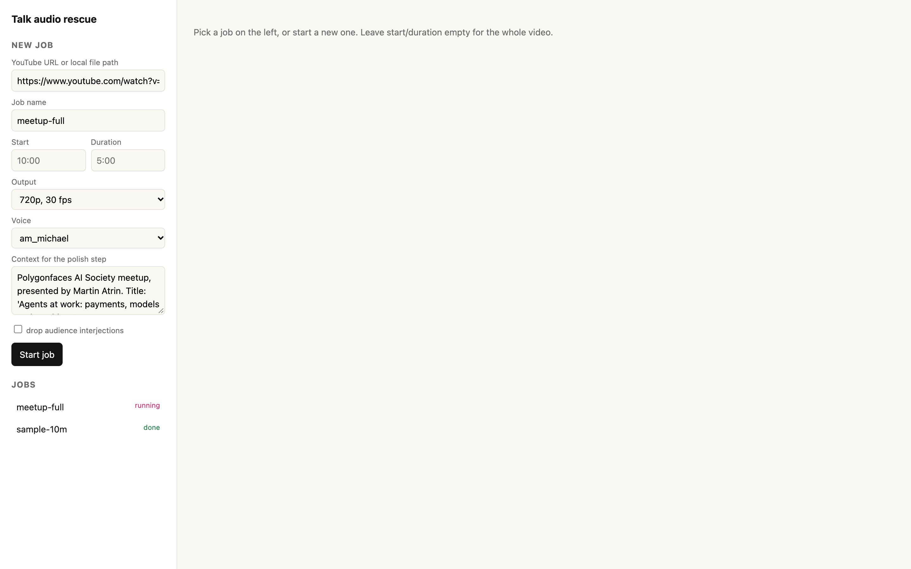
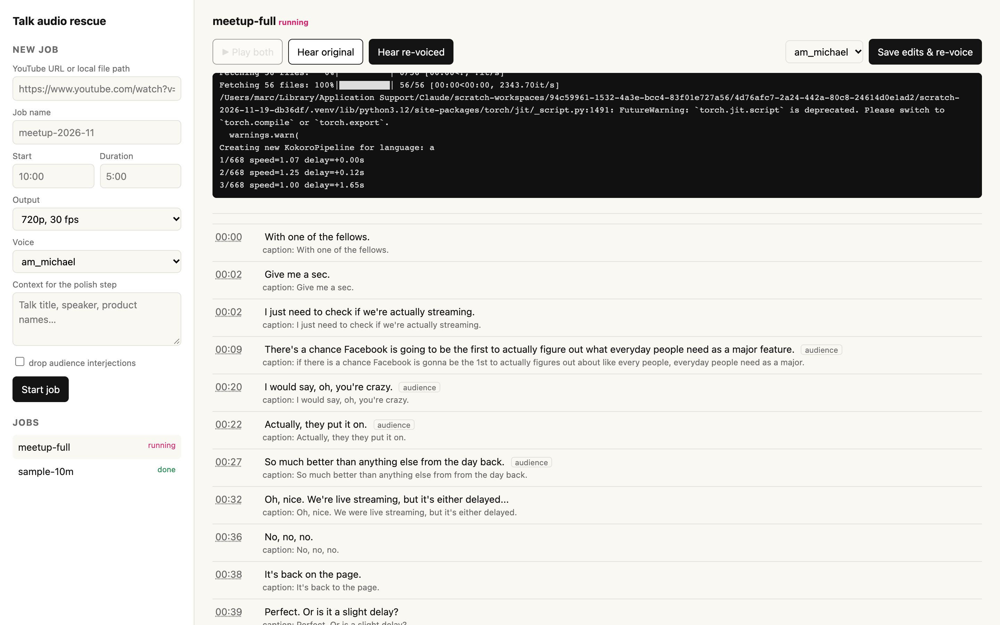
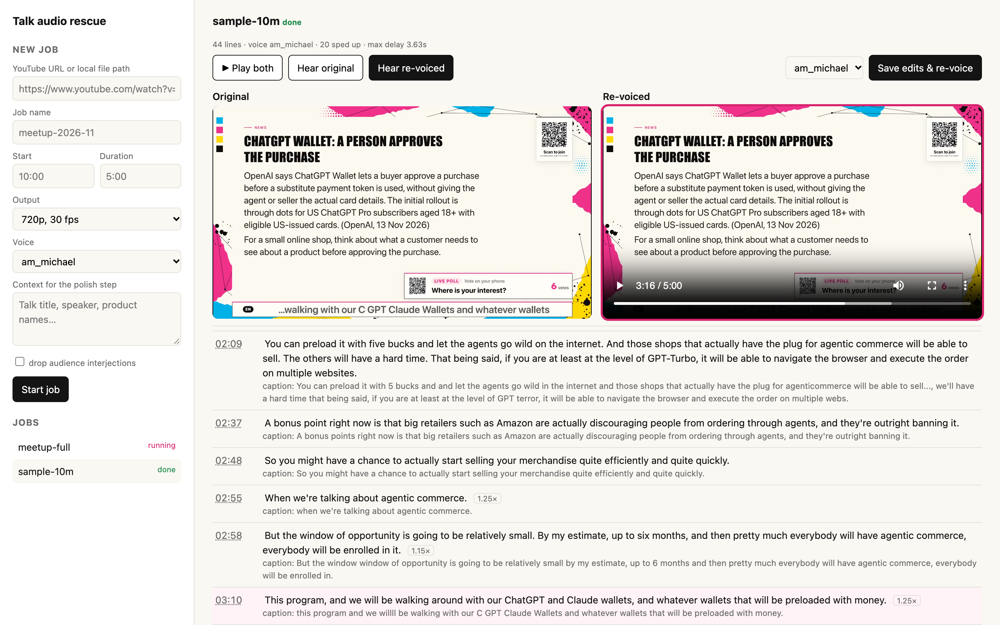
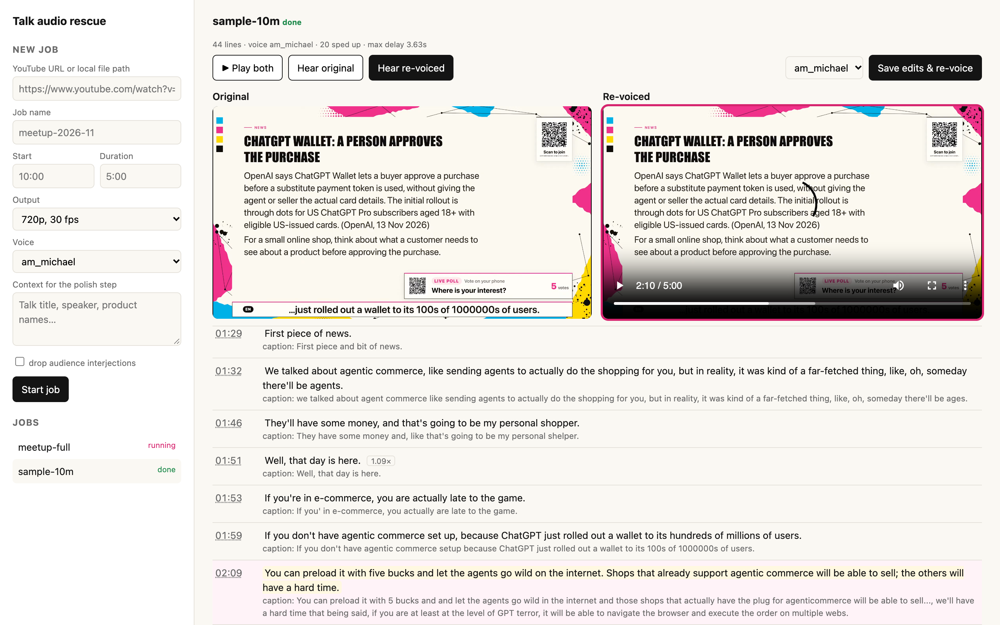
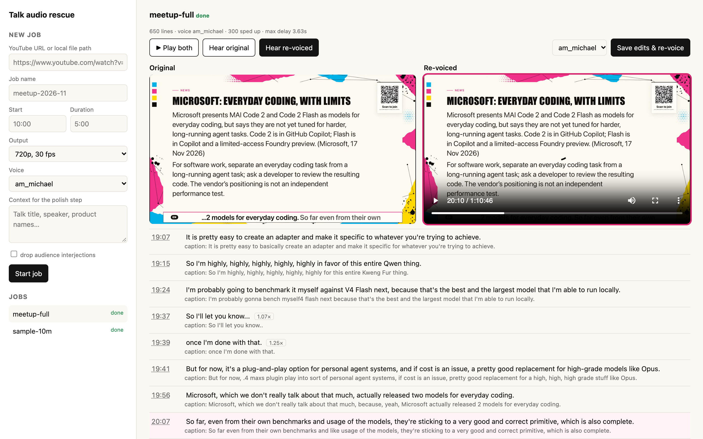

# Build log: rescuing a meetup livestream with unusable audio

These are raw notes for a later blog post or website page. They cover facts, numbers, decisions and dead ends, in order.

## The problem (2026-11-19)
- We livestreamed the Polygonfaces AI Society meetup ("Agents at work: payments, models and machines", presented by Martin Atrin) to YouTube. The video is 1:10:47 long.
- The audio is bad. Both microphones in the room were recording at the same time and the stream mixed them into one track, so the signals smeared over each other. Over a 5-minute window, RMS is −17.7 dB and the noise floor is −19.6 dB, so speech sits only about 2 dB above the noise.
- The stream had live captions burned into the bottom of the slides. That means *what was said* is visible on screen, even though you can't hear it.

## Step 1: Download
- `yt-dlp` gives 1080p60 H.264 (format 299) plus Opus audio at ~99 kbps and 48 kHz (format 251). We kept the separate streams as well as the merged file.

## Step 2: Try to save the real voice (dead end)
We tested on a 5-minute sample (10:00–15:00) with three tools:
| Method | Result |
|---|---|
| DeepFilterNet 3 | Removed the noise, and the voice with it. RMS fell from −17.7 to −32.5 dB. |
| Demucs `htdemucs`, vocals stem | Barely changed anything (RMS −18.2 dB, noise floor −21 dB) |
| Demucs, then DeepFilterNet | Same as DeepFilterNet alone |

- **Objective test:** we transcribed the first 2 minutes of each version with Whisper large-v3-turbo.
  - Original: hallucinated French fragments
  - DFN and Demucs+DFN: "Thank you. Thank you. Thank you."
  - Demucs only: "I am driving 193 reasons for driving…"
- **Conclusion:** the speech information isn't in the recording. No enhancer can bring back what was never captured.
- Practical notes:
  - Demucs crashes on Apple's MPS backend ("Output channels > 65536 not supported"). It works on CPU and takes ~80 s for 5 minutes.
  - DeepFilterNet needs `torch<2.6` because of a removed torchaudio API, which conflicts with Kokoro (`torch>=2.6`). That's one reason the final pipeline doesn't include it.

## Step 3: Read the captions instead (OCR)
- The caption bar is one line of crisp dark text on a white box at a fixed position, so we just crop it.
- **OCR engine:** Apple Vision, called from Python via `ocrmac`. It's built into macOS, free and fast. The plan had considered `baidu/Unlimited-OCR`, but a large model is overkill for one crisp line of UI text.
- Sampling at 4 fps and skipping frames whose strip didn't change gave **309 caption states for 5 minutes, in 43 s**.
- OCR quality was close to perfect. The only systematic slips were "Al" for "AI" and "I'II" for "I'll", which a regex fixes.
- **The captions are live ASR, not ground truth.** They contain their own mis-hearings ("vote in Nep poll", "GPT terror", "agenticommerce"). The line scrolls, starts with "…", and words appear grey (still changing) before they turn black (final).

## Step 4: Stitch the scrolling line into sentences
- Each OCR state is a moving window onto the transcript, and later windows may revise earlier words.
- **Approach:** align each new state against the last ~40 words with `difflib.SequenceMatcher`. Anchor on the first match of at least 2 words, then replace everything after it with the new state. Words that survive keep their first-seen time.
- Then split into sentences at `.?!` and subtract ~1 s for live-ASR latency.
- **Result:** 709 words and 44 timed sentences for the 5-minute sample. A re-run on a fresh setup produced identical text.

## Step 5: Polish with an LLM
- Headless Claude Code (`claude -p`) gets about 40 sentences at a time, plus context about the talk (title, speaker, topics). It returns JSON with the same item ids, so timings can't drift.
- It fixes mis-hearings, punctuation and doubled words, writes numbers out for TTS ("100s of 1000000s" → "hundreds of millions"), and tags audience interjections.
- **Watch out:** with garbled input the LLM *guesses*. For example, "GPT terror" became "GPT-powered browsing". The raw caption is kept next to the polished text so a human can check guesses like that. LLM output also varies a little between runs; edit `polished.json` to lock in a version.

## Step 6: Re-voice with Kokoro on MLX
- Kokoro-82M through `mlx-audio`, with weights `mlx-community/Kokoro-82M-bf16`. After warm-up it renders about 6 s of speech in 0.3 s, roughly 20× real time on Apple Silicon.
- Setup gotchas:
  - The Homebrew `mlx_audio` install was missing `misaki`. Kokoro's English front-end also needs `en_core_web_sm`.
  - The pip `espeakng-loader` data path didn't work here. We pointed `ESPEAK_DATA_PATH` at Homebrew's `espeak-ng-data`.
- **Timing:**
  - Each sentence owns the time until the next sentence starts.
  - If the TTS is longer than that slot, it's re-synthesized with Kokoro's `speed` parameter (up to 1.25×). That sounds better than time-stretching afterwards.
  - If it still overruns, the following lines are pushed back until the next pause.
- **Sample result:** 44 lines, 20 needed a speed-up (Kokoro at 1.0× is slower than a live speaker), 6 lines were more than 1 s late, and the worst delay was 3.6 s. On slides that's not noticeable.
- No lip-sync is needed, since it's slides.
- **Check:** Whisper transcribes the new narration word-for-word, compared with the original audio, where it heard nothing usable.

## Step 7: Remux
- `ffmpeg`: the video stream is copied unchanged, the narration is loudness-normalized to −16 LUFS as AAC, and the polished transcript is added as a soft `mov_text` subtitle track.

## Step 8: The full talk, and the bug the sample didn't show
- The first full run (70 min, 720p) gave 3,871 caption states and 668 sentences. The narration report then said **max delay 58.7 s**, against 3.6 s on the sample.
- **The cause:** at ~66 min the stream switches to a **screen share of a website**. With no caption bar on screen, OCR read whatever page text scrolled through the crop area: "Work email", "Free, or Pro for thirty dollars", "Privacy notes", "Cookie settings". That made 12 "sentences" in 4 seconds. Each was voiced in full and pushed the next one back, until the narration ran a minute behind.
- **The fix:** OCR only when the caption bar is actually on screen. The bar has a cheap pixel signature: a white margin (mean ≈ 251), the dark "EN" badge (≈ 68), and a mostly bright text area (77 % of pixels > 200). On the screen-share frame all three disappear (27 / 17 / 0 %).
  - On a normal caption clip, OCR output was byte-identical before and after the fix.
  - In the screen-share window it skips 1.7 minutes and picks the captions up again when the bar returns.
- **The lesson:** a 5-minute sample tests the method, not the whole recording. A summary metric (max delay) caught what spot-listening wouldn't have.
- The 720p OCR matched the 1080p sample at 98.4 % word similarity over the same 5 minutes, so 720p is fine for slides.

### Full-talk result (after the fix)
| | First run | After caption-bar detection |
|---|---|---|
| Caption states | 3,871 | 3,786 (6.8 min without a caption bar skipped) |
| Sentences voiced | 668 | 650 |
| Max delay vs. original timing | **58.7 s** | **3.6 s** |
| Median / 95th-percentile delay | — | 0.0 s / 1.95 s |
| Lines sped up (≤ 1.25×) | 306 | 300 |
| Lines tagged as audience | 62 | 55 |

- The output is 1:10:46 at 720p30 H.264, plus AAC narration and soft English subtitles, 165 MB.
- **Spot check:** Whisper on the narrated 40:00–40:40 reproduces the polished transcript word for word.
- **Nice polish example:** the live caption said "highly for this entire Kweng Fur thing", and the polish fixed it to "…this entire Qwen thing".
- **Known gaps:** two live-browser demos (59:45–63:03 and 65:00–67:21, ~5.6 min) had no caption bar on screen, so there is nothing to voice and the re-voiced version is silent there.
- **Timings, full talk, from a downloaded source:**
  - OCR ~10 min
  - Polish ~4 min (17 calls to `claude -p`)
  - TTS ~4 min
  - Remux ~1.5 min
  - Total ≈ 20 min for 71 min of video.

## Step 9: A small UI
- `ui.py` uses only the Python standard library and listens only on localhost. It serves `ui.html`, starts `rescue.py` jobs, and streams the job log. It serves videos with HTTP Range support, so seeking works.
- Two players show the original and the re-voiced video, locked in sync. Only one is audible at a time.
- Each transcript line shows the polished text, the raw caption and a speed tag. Lines are editable: change the text, click "Save edits & re-voice", and only the TTS step runs again (~30 s for 5 minutes).
- URL-hash presets (`#job=…&t=…&edit=…`) open an exact state. `docs/screenshots.py` uses them to take 2× screenshots with Playwright driving the installed Chrome.
  - We tried Chrome's built-in `--headless --screenshot` first, but its virtual-time mode returned blank pages once streaming video was on the page.
  - The browser pane in the Claude app renders at only ~800 px wide, which is too small for blog images.

*Start a job from a YouTube URL or a local file. The context field gives the polish step names and terms.*

*A running job: the log streams live.*

*Original vs re-voiced, in sync. The highlighted line is the one playing now; the speed tags show where a line was squeezed to fit.*

*Fixing a line by hand. Edited text turns yellow, and "Save edits & re-voice" re-renders only the narration.*

*The finished full-length job.*

## Timings (5-minute sample, M-series Mac)
| Stage | Time |
|---|---|
| OCR | 43 s |
| Stitch | <1 s |
| Polish (LLM) | ~30 s |
| TTS + remux | ~30 s |
| Whole pipeline from a local file | ~90 s |

## Feedback after publishing
- Martin spotted a miss: an audience member said "you can do that on Grok bot". The live caption read "RPL", and the polish step turned it into "the app". Grok bot comes up again later in the talk, so a second pass over the full transcript with a list of names found in it would likely catch this. Not done for this video.

## Ideas not done yet
- A second polish pass over the whole transcript with a glossary of names that appear anywhere in it (would have caught "RPL" → "Grok bot").
- A voice clone of the speaker (Qwen3-TTS or ElevenLabs). This needs the speaker's consent.
- Pulling a glossary from the slide text with OCR, to give the polish step better names and terms.
- A faster base speed (e.g. 1.1×) so fewer lines need squeezing.
